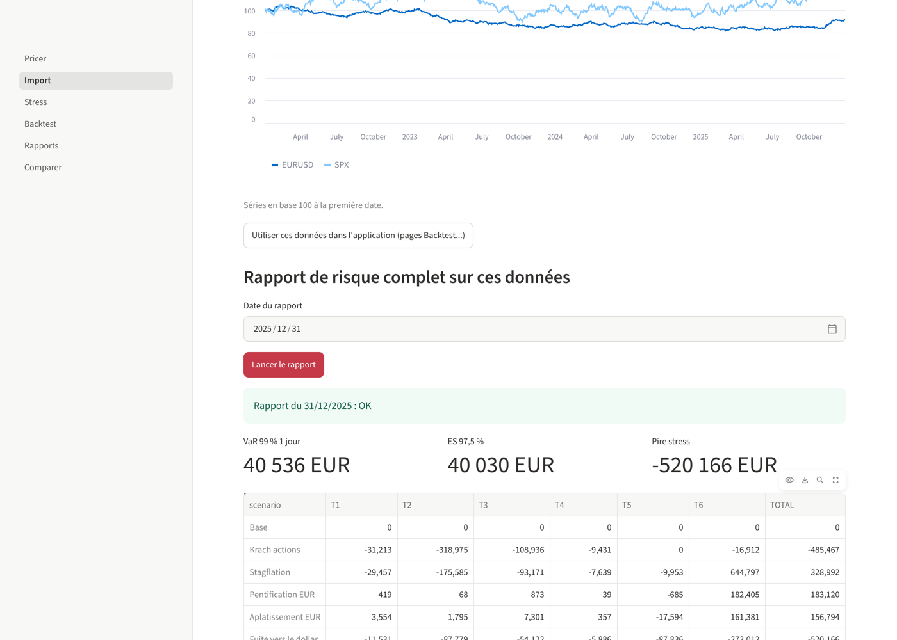
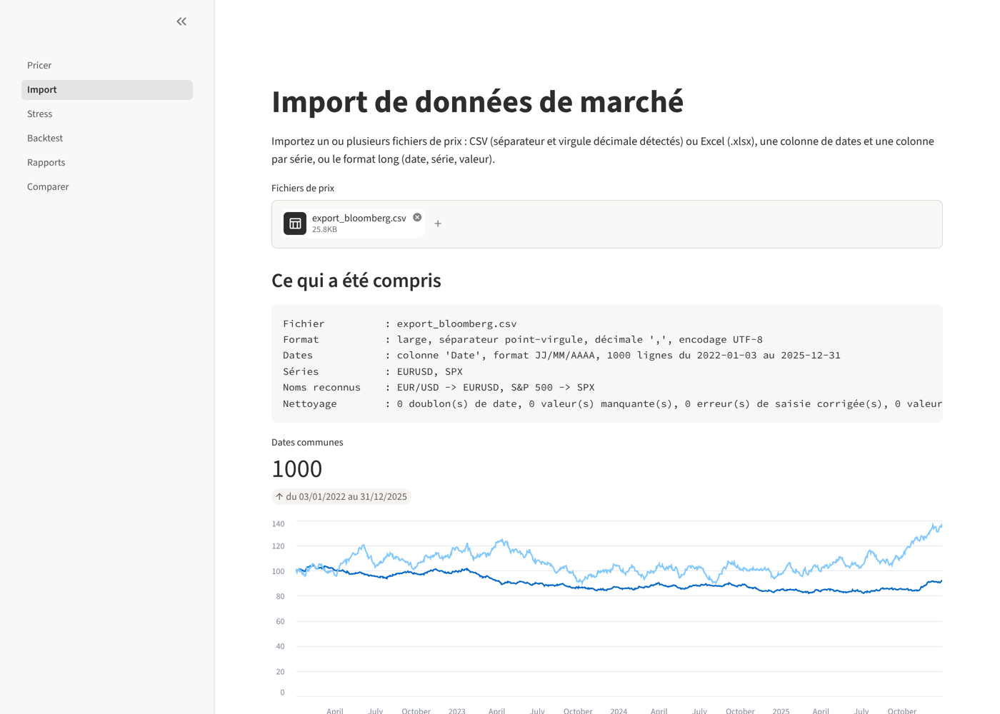
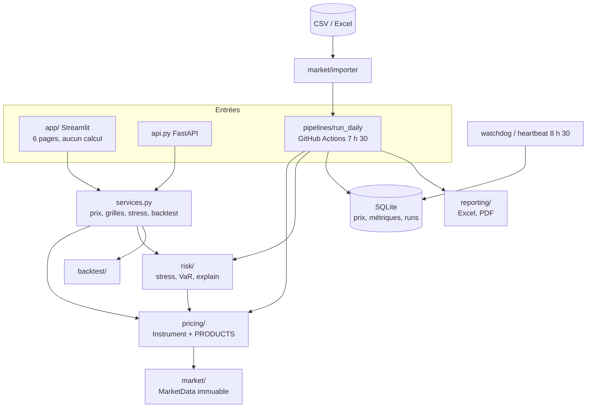

# quantlab


Plateforme de risque pour un petit book d'options actions / change : elle importe des fichiers de prix
(CSV ou Excel), valorise chaque position, calcule les Greeks, applique une bibliothèque de stress, une VaR
historique, contrôle les limites, et produit chaque jour ouvré un rapport Excel + PDF sans intervention. Une application Streamlit permet d'explorer les mêmes calculs,
et une API FastAPI les expose à d'autres programmes.

> Projet personnel. Toutes les données fournies sont **synthétiques** (générées par `quantlab.make_sample_data`) :
> aucun chiffre ne décrit un marché réel.

**Application en ligne :** https://<nom-app>.streamlit.app



## Installation (3 commandes)

Python 3.11 à 3.14, testé en CI sous Windows, macOS et Linux.

macOS / Linux :

```bash
git clone https://github.com/<pseudo-github>/quantlab.git && cd quantlab
python3 -m venv .venv && source .venv/bin/activate && pip install -e ".[dev]" -c constraints.txt
python -m quantlab.pipelines.run_daily --config config/settings_demo.yaml --date 2025-12-31 && streamlit run app/Pricer.py
```

Windows (PowerShell) :

```powershell
git clone https://github.com/<pseudo-github>/quantlab.git; cd quantlab
py -m venv .venv; .venv\Scripts\Activate.ps1; pip install -e ".[dev]" -c constraints.txt
python -m quantlab.pipelines.run_daily --config config/settings_demo.yaml --date 2025-12-31; streamlit run app/Pricer.py
```

`-c constraints.txt` installe exactement les versions avec lesquelles le projet a été testé.

La troisième commande produit le rapport du 31/12/2025 dans `demo/reports/2025-12-31/` (environ 45 s),
puis ouvre l'application sur http://localhost:8501. Testé sur une installation propre : environ 1 min 30 s
à 2 min 30 s au total selon le cache pip.

Guide complet (import de données, API, configuration, planification, dépannage) : [docs/guide.md](docs/guide.md).

## Importer ses propres données

```bash
python -m quantlab.market.importer mes_prix.xlsx                    # ce que le fichier contient, sans calcul
python -m quantlab.pipelines.run_daily --config config/settings_demo.yaml --prices mes_prix.xlsx
```

Ou dans l'application, page **Import** : glisser un fichier, lire ce qui a été compris, lancer le rapport.

L'importateur reconnaît sans configuration les CSV (`,` `;` tabulation, UTF-8 ou Windows-1252, virgule décimale
des exports Excel français) et les classeurs `.xlsx`, les dates ISO, `JJ/MM/AAAA` ou `MM/JJ/AAAA`, le format
large (une colonne par série) ou long (`date, série, valeur`), et les noms usuels (`EUR/USD` → `EURUSD`,
`^GSPC` → `SPX`). Il retire pieds de page et colonnes de texte, masque une erreur de saisie isolée sans toucher
à un vrai krach, refuse un fichier inutilisable avec un message clair, et consigne chaque correction dans un
rapport d'import.



## Ce que fait le projet

| Besoin | Où |
|---|---|
| Importer des prix (CSV, Excel) et relancer tout le rapport dessus | App, page Import · `--prices` |
| Pricer un produit et voir ses Greeks, son payoff, sa grille spot × vol | App, page Pricer · `POST /price` |
| Stresser le book (bibliothèque de scénarios ou scénario composé) | App, page Stress · rapport du matin |
| VaR historique 99 % et ES 97,5 % | Rapport du matin |
| Backtester des croisements de moyennes mobiles, avec garde-fous contre la sur-optimisation | App, page Backtest |
| Rapport Excel (Synthèse, Limites, Positions, Stress, VaR) et PDF (2 pages) chaque jour ouvré à 7 h 30 | `.github/workflows/daily.yml` |
| Alerte si le rapport est incomplet, en échec, ou absent à 8 h 30 | `alerts.py`, `watchdog.py`, `heartbeat.yml` |

Produits : forward, option européenne, option de change (Garman-Kohlhagen), digitale, barrière up-and-out
(Monte Carlo), note à capital garanti, autocall (Monte Carlo).

## Architecture



Un seul code de calcul, trois points d'entrée : un prix affiché dans l'app est identique à celui du rapport
et de l'API (testé). Détails : [docs/architecture.md](docs/architecture.md). Choix et alternatives écartées :
[docs/decisions.md](docs/decisions.md).

## Tests

```bash
pytest -m "not slow"     # 238 tests, ~15 s : pendant le développement
pytest                   # 260 tests, ~2 min : avant un commit (et en CI)
```

- Validation contre QuantLib (vanilles à 1e-8 ; critère du projet : 1e-4), parité call-put à 1e-10, cas limites à prix exact pour les Monte Carlo.
- Golden file du rapport de référence (`tests/golden/`), tolérance 1 EUR. Régénération volontaire :
  `pytest tests/test_golden.py --update-golden`, puis relire `git diff`.
- Importateur : export Excel français, format long, dates ambiguës, erreur de saisie contre vrai krach,
  fichiers invalides.
- Quatre pannes simulées (API 500, JSON corrompu, spot manquant, book vide) : code de sortie, statut en base,
  contenu de l'alerte.
- Couverture : 89 % sur `pricing/` et `risk/`.

## Ajouter un produit

1. Une classe `MonProduit(Instrument)` dans `pricing/instruments.py` avec `unit_price(md)` (et `payoff`).
2. Une ligne dans `PRODUCTS`.
3. Des tests, dont au moins un cas limite à prix connu.

Les Greeks, le stress, la VaR, le rapport et l'API fonctionnent sans autre modification. Exemple : l'autocall
(65 lignes, 7 tests).

## Hors périmètre

Données temps réel, multi-utilisateurs, smile de volatilité (Heston, SABR, vol locale), authentification.

## Licence

MIT
